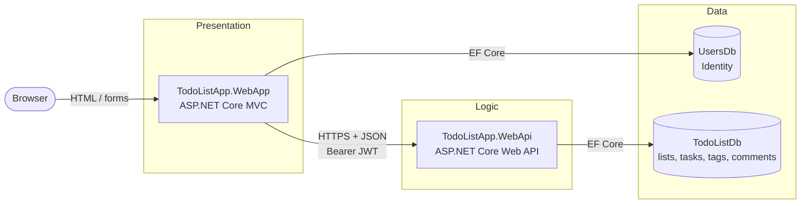
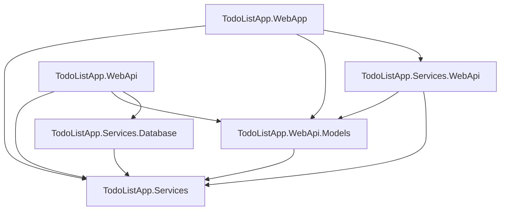
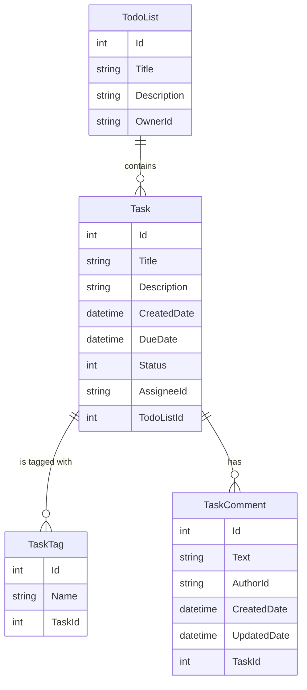

# To-do List Application

A to-do list web application built with **ASP.NET Core 8**: an MVC web app for the browser UI and a separate RESTful Web API that owns the data. Users sign up, create to-do lists, add tasks with due dates and statuses, tag and comment on tasks, and see which of their tasks are overdue.

> This was my **capstone (final) project for the .NET Fundamentals course at EPAM**. I designed and wrote the code myself, following the course requirements.

## Features

- **Accounts:** sign up, sign in, sign out and password reset (ASP.NET Core Identity).
- **To-do lists:** create, edit, delete and view your own lists.
- **Tasks:**
  - title, description, due date and status (Not started, In progress, Completed);
  - full CRUD inside a list and a task details page;
  - overdue tasks are highlighted.
- **Assigned to me:** every task you are assigned, with filtering by status, sorting and a quick status change.
- **Search:** find tasks by text in their title; overdue results are highlighted.
- **Tags:** add and remove tags on a task, browse all tags, and open the tasks that have a given tag.
- **Comments:** add, edit and delete comments on a task.
- **Paging:** every API endpoint that returns a list is paginated.

## Tech stack

| Area | Technology |
|------|------------|
| Platform | .NET 8, C# |
| Web UI | ASP.NET Core MVC, Razor views, Bootstrap, custom CSS |
| API | ASP.NET Core Web API (controllers), Swagger / OpenAPI |
| Data access | Entity Framework Core 8 (code-first, migrations) |
| Database | SQL Server (LocalDB for development), two databases |
| Auth | ASP.NET Core Identity (web app), JWT Bearer tokens (web app → API) |
| Code quality | .NET analyzers (`AllEnabledByDefault`), StyleCop.Analyzers, `.editorconfig` |

## Architecture

The solution is a **3-tier application**:

1. **Presentation tier:** `TodoListApp.WebApp`, the MVC site the user works with in the browser.
2. **Logic tier:** `TodoListApp.WebApi`, a RESTful API. The web app never touches the to-do database directly; it reads and writes all to-do data through this API.
3. **Data tier:** SQL Server with two databases:
   - `UsersDb` holds Identity data (users, password hashes) and is used only by the web app;
   - `TodoListDb` holds to-do lists, tasks, tags and comments and is used only by the API.



### Projects

| Project | Type | Responsibility |
|---------|------|----------------|
| `TodoListApp.WebApp` | ASP.NET Core MVC | Controllers, Razor views, Identity (`UsersDb`), and an HTTP handler that attaches a JWT to every API call. |
| `TodoListApp.WebApi` | ASP.NET Core Web API | REST controllers, request validation, error handling and logging, and JWT Bearer authentication. |
| `TodoListApp.Services` | Class library | The shared domain model (`TodoList`, `TodoTask`, `TaskComment`, …) and the service interfaces. |
| `TodoListApp.Services.Database` | Class library | `TodoListDbContext`, EF Core entities and the database services that implement the interfaces. |
| `TodoListApp.Services.WebApi` | Class library | API clients built on `HttpClient` that implement the same interfaces on the web app side. |
| `TodoListApp.WebApi.Models` | Class library | The request and response models (DTOs) of the REST API, shared by the API and its clients. |



The domain model and the service interfaces live in one shared library, `TodoListApp.Services`, and there are two implementations of them:
- the **database services** (`TodoListDatabaseService`, `TaskDatabaseService`, …) used by the API;
- the **web API services** (`TodoListWebApiService`, `TaskWebApiService`, …) used by the web app.

Controllers depend only on the interfaces and get their services through constructor injection.

### Authentication between the two apps

1. A user signs in to the **web app** with ASP.NET Core Identity and gets a cookie.
2. For every request to the API, `WebApiAuthenticationHandler` (an `HttpClient` `DelegatingHandler`) creates a short-lived **JWT**. The token holds the user's id and email and is signed with a key shared by both apps.
3. The **API** validates the token's signature, issuer, audience and lifetime, takes the user id from it, and returns only the lists and tasks that user owns or is assigned.

### Data model



- **Ownership:** `OwnerId`, `AssigneeId` and `AuthorId` are the Identity user ids from `UsersDb`. They live in a different database, so they are plain columns without foreign keys.
- **Cascade delete:** deleting a list deletes its tasks, and deleting a task deletes its tags and comments.
- **Indexes:** the columns used for filtering (owner, assignee, tag name) are indexed, and a tag name is unique within a task.

### REST API

| Method | Route | Description |
|--------|-------|-------------|
| GET, POST | `/api/todolist` | List (paged) / create to-do lists |
| GET, PUT, DELETE | `/api/todolist/{id}` | Get / update / delete a to-do list |
| GET, POST | `/api/todolist/{todoListId}/tasks` | List (paged) / add tasks of a list |
| GET, PUT, DELETE | `/api/tasks/{id}` | Get / update / delete a task |
| PUT | `/api/tasks/{id}/status` | Change only the status of a task |
| GET | `/api/tasks/assigned` | Tasks assigned to the current user (filter, sort, paging) |
| GET | `/api/tasks/search` | Search tasks by title |
| GET | `/api/tags` | Tags of the tasks the user can access (paged) |
| GET | `/api/tags/{name}/tasks` | Tasks that have a tag (paged) |
| POST | `/api/tasks/{taskId}/tags` | Add a tag to a task |
| DELETE | `/api/tasks/{taskId}/tags/{name}` | Remove a tag from a task |
| GET, POST | `/api/tasks/{taskId}/comments` | List (paged) / add comments of a task |
| GET, PUT, DELETE | `/api/comments/{id}` | Get / edit / delete a comment |

**Responses and errors:**
- success returns `200`, `201` (with a `Location` header) or `204`;
- invalid input returns `400` with validation details;
- a missing token returns `401`;
- a resource the user doesn't own or that doesn't exist returns `404`;
- an unexpected error returns `500` and is logged.

In development the API serves **Swagger UI** at `/swagger`.

## Getting started

### Prerequisites

- [.NET 8 SDK](https://dotnet.microsoft.com/download/dotnet/8.0)
- SQL Server LocalDB. It comes with the Visual Studio "ASP.NET and web development" workload. Any SQL Server works if you change the connection strings.
- The EF Core CLI: `dotnet tool install --global dotnet-ef --version 8.*`

### 1. Set the token signing key

The key that signs and validates the JWTs is a secret, so it is **not** stored in `appsettings.json`. Generate a random key and save the same value for both apps with [User Secrets](https://learn.microsoft.com/aspnet/core/security/app-secrets):

```bash
KEY=$(openssl rand -base64 48)
dotnet user-secrets set "Authentication:SecurityKey" "$KEY" --project TodoListApp.WebApi
dotnet user-secrets set "WebApi:SecurityKey" "$KEY" --project TodoListApp.WebApp
```

On Windows PowerShell, generate the key with:
```powershell
$bytes = New-Object byte[] 48; [Security.Cryptography.RandomNumberGenerator]::Create().GetBytes($bytes)
$KEY = [Convert]::ToBase64String($bytes)
```

### 2. Create the databases

```bash
dotnet ef database update --project TodoListApp.Services.Database --startup-project TodoListApp.WebApi
dotnet ef database update --project TodoListApp.WebApp
```

### 3. Run

Start the API and the web app, each in its own terminal:

```bash
dotnet run --project TodoListApp.WebApi --launch-profile https
dotnet run --project TodoListApp.WebApp --launch-profile https
```

Then open <https://localhost:7212>, sign up, and create your first list. The API runs on <https://localhost:7292>; its Swagger UI is at `/swagger`.

> **Password reset:** the project has no email service. `LoggingEmailSender` writes the reset link to the web app's console log instead of sending an email.

## Code quality

- **Analyzers:** every project has the built-in .NET analyzers enabled (`AnalysisMode=AllEnabledByDefault`) and StyleCop.Analyzers. The solution builds with **0 warnings**.
- **Documentation:** public types and members have XML documentation comments.
- **Logging:** uses the high-performance `[LoggerMessage]` source generator.
- **Error handling:** each controller action handles the exceptions it expects with a matching status code. Anything unexpected returns `500` and is logged.

## About

Built as the capstone project of the EPAM .NET Fundamentals course. The requirements (two web apps, a 3-tier architecture, EF Core code-first, Identity and the user-story backlog) came from the course. The design and the code are my own work.
